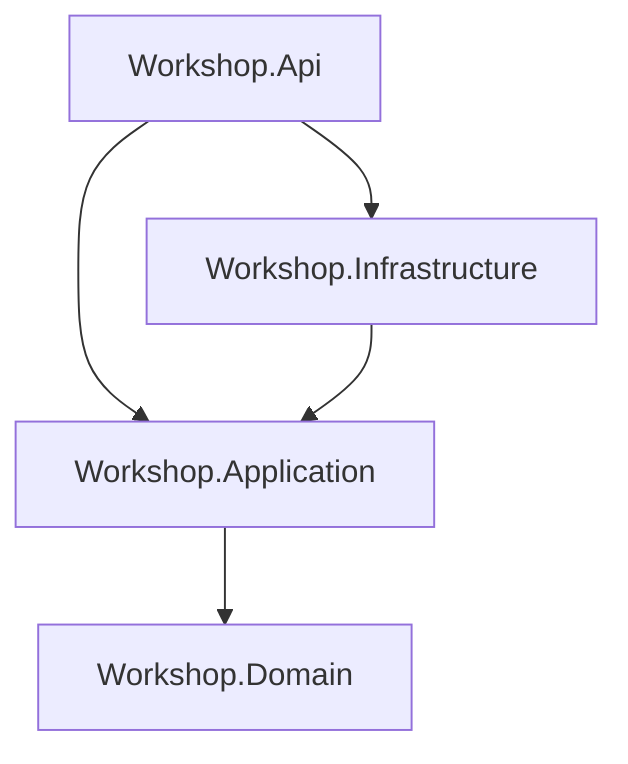
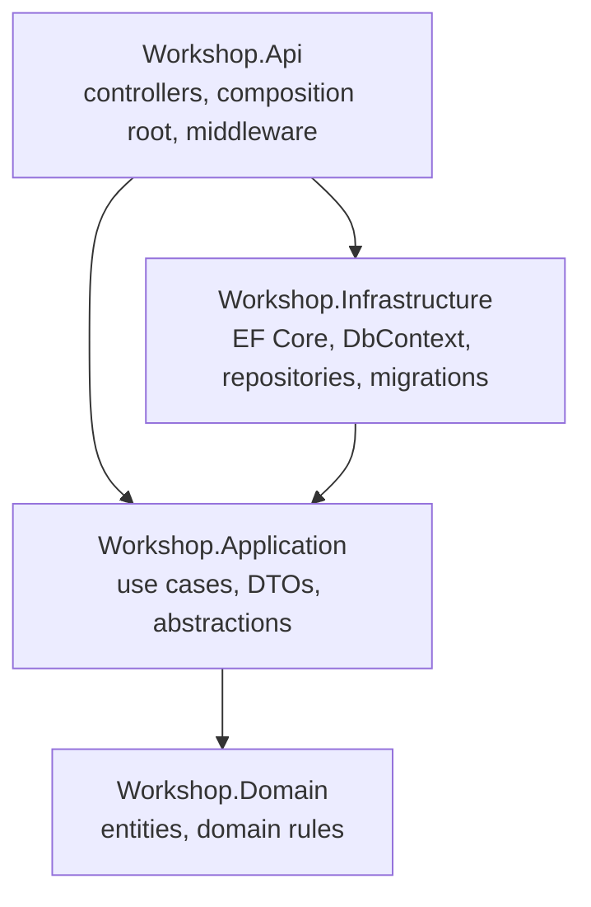

# Dependency Flow

This document describes the dependency direction between the projects and the
responsibilities of each layer. The direction is enforced by project references
(`.csproj`): the compiler rejects any violation of the file-level references,
and the arrows below must always point **inward**.

## The dependency rule

Source-code dependencies point inward. An inner layer never knows about an
outer layer:

- `Workshop.Domain` is the center and depends on nothing.
- `Workshop.Application` depends only on `Workshop.Domain`.
- `Workshop.Infrastructure` depends on the layer whose abstractions it
  implements: `Workshop.Application`.
- `Workshop.Api` is the composition root and depends on `Workshop.Application`
  and `Workshop.Infrastructure` (the latter only to wire up dependency
  injection at startup).

The invariant: `Application` never references `Infrastructure` (or EF Core), and
`Domain` never references any other project.

## Project dependencies

> `Workshop.Infrastructure` reaches `Workshop.Domain` transitively through
> `Workshop.Application`. A **direct** `Infrastructure -> Domain` reference is
> also allowed when Infrastructure maps domain entities with EF Core: it is
> still an inward dependency and does not break the rule.

## Layer stack

## Responsibility per layer

| Layer | Responsibility | May reference |
|-------|----------------|---------------|
| **Workshop.Domain** | Entities, value objects, domain rules. Pure C#, no framework code. | nothing |
| **Workshop.Application** | Use cases (services), DTOs, repository abstractions, mapping. | Domain |
| **Workshop.Infrastructure** | EF Core, `ApplicationDbContext`, repository implementations, migrations. | Application (and Domain for entity mapping) |
| **Workshop.Api** | Controllers, composition root (`Program.cs`), middleware. | Application, Infrastructure |

## Rules

- Dependencies point **inward**: Api -> Application -> Domain.
- Infrastructure **depends on** Application because it implements the
  abstractions (repository interfaces) declared in Application. Application must
  never depend on Infrastructure, EF Core, or any persistence package.
- Domain references nothing except the base class library.
- Repository interfaces live in Application; their implementations live in
  Infrastructure. Dependency injection wires them together in `Program.cs`.
- Nothing references Workshop.Api.

## Violations to watch for

- EF Core (or any persistence package) referenced by Application or Domain.
- Application referencing Infrastructure.
- Persistence concerns (DbContext, migrations, EF attributes) leaking into
  Domain entities — keep the mapping in Infrastructure.
